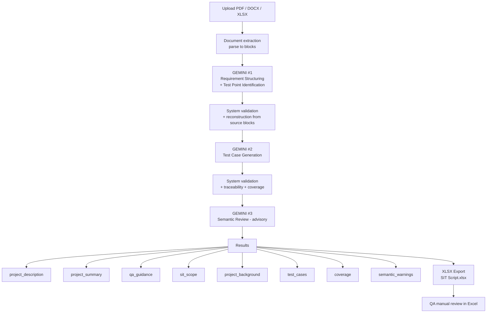
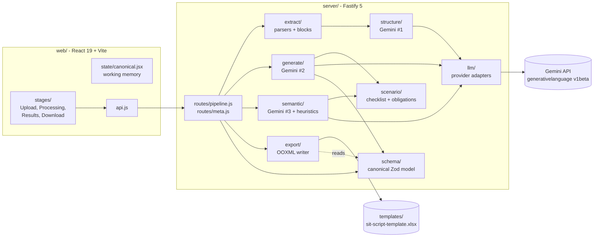
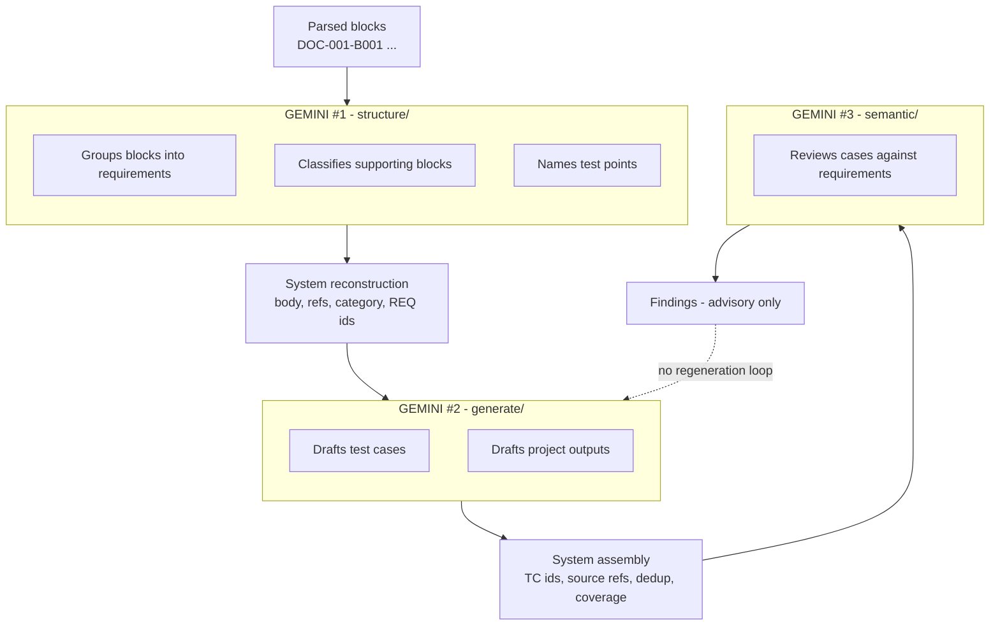
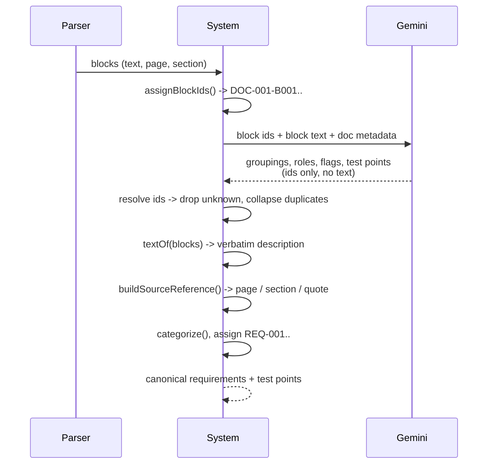
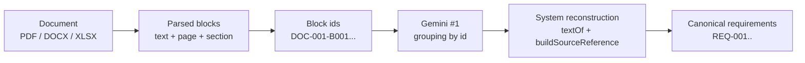
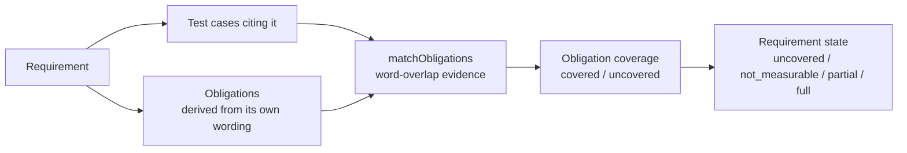
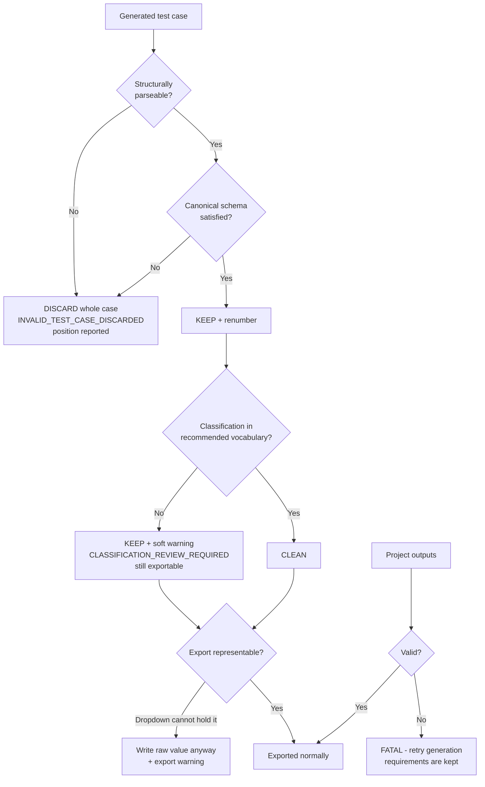
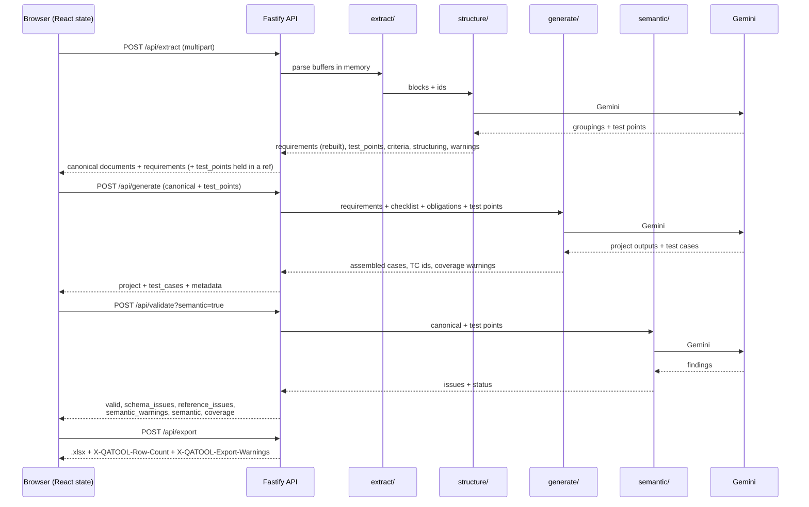

# QATOOL - implementation reference

> **Document map:** this is the detailed implementation reference (it was the root `README.md`
> until the 2 November 2026 cleanup). Start with [`../README.md`](../README.md) for setup and an
> overview, and [`../CLAUDE.md`](../CLAUDE.md) for the working context for Claude Code.
> Some Apayee notes below ("mock provider only") predate the Claude provider that Apayee now
> offers; the model-selection behaviour in 17.2 is current.

Internal QA productivity tool for turning project documents (PRD, RFC, specs)
into a reviewed **SIT Script** workbook. A QA analyst uploads documents, three
AI calls draft the material, deterministic code validates and owns every
identifier and traceability link, and the run ends in an `.xlsx` built from the
office template that QA reviews by hand.

**AI drafts. Deterministic code validates. QA decides.**

> **Target architecture (not yet implemented):** the QAI P0 pipeline — two LLM
> calls, run-scoped artifact storage, no obligation engine, existing workbook
> plus red highlighting for rows that need QA review — is specified in
> [`QAI_Blueprint_v4_P0_Refinement.md`](QAI_Blueprint_v4_P0_Refinement.md).
> This README describes the pipeline as it is implemented today.

---

## 1. Product Overview

### The problem

Preparing a SIT Script means reading a PRD or RFC, finding the statements that
are testable, writing a test case for each behaviour, keeping a traceability
link back to the source, and typing all of it into a fixed office spreadsheet.
The work is repetitive, and the repetitive part is where coverage quietly goes
missing.

### Target user

A QA analyst preparing System Integration Testing material. One person, one
session, one deliverable.

### Primary workflow

```
Upload  ->  Processing  ->  Results  ->  Download
```

Four stages in one browser tab (`web/src/stages/`). The canonical project lives
in React state and is posted to stateless endpoints at each step.

### What QATOOL is

- A **batch drafting tool**. It produces a first draft of the SIT Script and the
  surrounding project text, with warnings about what it could not do safely.
- A **traceability engine**. Every test case traces to a requirement, every
  requirement to a document, page or section, and the system — not the model —
  owns that chain.
- **Stateless and single-session**. Confirmed in code: no database, no server
  session, no browser storage, nothing written to disk.
  `server/no-persistence.test.js` asserts this rather than trusting it.

### What QATOOL is NOT

- Not a review system. There is no approve/reject step, no `review_status`, and
  no project history. Final review happens in Excel after export.
- Not a test execution engine. `status` and `tested_by` exist in the canonical
  model and are deliberately exported blank.
- Not a replacement for QA judgement. Every AI output is a draft, and the
  reviewer call is advisory only.

---

## 2. Goals

Goals the current implementation actually serves:

| Goal                                                           | How the code serves it                                                                                                  |
| -------------------------------------------------------------- | ----------------------------------------------------------------------------------------------------------------------- |
| Draft SIT material from documents without copy-paste           | Three-call pipeline, `/api/extract` → `/api/generate` → `/api/validate`                                                 |
| Never let AI invent a requirement, a source reference or an id | Requirement bodies rebuilt from parsed blocks; ids assigned in `server/lib/ids.js`; references derived in `assemble.js` |
| Keep traceability machine-checked                              | `checkCanonicalReferences()` in `server/schema/canonical.js`                                                            |
| Report what could not be done, instead of hiding it            | Warning codes at every stage; `INSUFFICIENT_INFORMATION` is a first-class outcome                                       |
| Produce a workbook the office template accepts                 | Surgical OOXML rewrite in `server/export/`, self-verified before return                                                 |
| Leave no confidential document content at rest                 | Buffers parsed in memory and discarded; no upload directory exists                                                      |
| Survive a provider outage without losing the run               | Deterministic fallback in `server/structure/index.js`; per-case discard in `server/generate/index.js`                   |

---

## 3. Non-Goals / Out of Scope

All confirmed by the current repository:

- **No persistent project history.** No database dependency, no `migrate`
  script, no upload directory — asserted by `server/no-persistence.test.js`.
- **No test execution engine.** Execution columns are exported blank.
- **No autonomous review → regenerate loop.** Gemini #3 returns findings; no
  code path regenerates from them.
- **No authentication.** The server binds to `127.0.0.1` by default. Anything
  beyond local single-user use needs auth first. _(Not implemented.)_
- **No OCR.** An image-only PDF extracts to zero characters and raises
  `LOW_EXTRACTED_TEXT`.
- **No silent repair.** Nothing normalises, reinterprets or fabricates a model
  value to make it fit.
- **No fixed test case count target.** More test cases is not a goal; more of
  the requirement being tested is.

---

## 4. User Workflow

Output names below are taken from `server/schema/project.js` and
`web/src/stages/ResultsStage.jsx`.



The Processing stage runs three phases (`web/src/stages/ProcessingStage.jsx`):

| Phase key  | Label shown to the user                    | Calls                                          |
| ---------- | ------------------------------------------ | ---------------------------------------------- |
| `extract`  | Extracting requirements from documents     | `POST /api/extract` (contains Gemini #1)       |
| `generate` | Generating test cases and project outputs  | `POST /api/generate` (Gemini #2)               |
| `validate` | Validating structure, coverage and meaning | `POST /api/validate?semantic=true` (Gemini #3) |

A failed phase leaves everything before it in memory. **Retry resumes from that
phase** — documents are not re-uploaded and earlier work is not repeated.

---

## 5. System Architecture



There is no database, cache, queue or worker. The only external service is the
Gemini API, reached only from `server/llm/`.

---

## 6. Three-Call AI Pipeline

Exactly **three** `generateJson` call sites exist in application code, verified
by grep:

| #   | Call site                      | Stage                                 |
| --- | ------------------------------ | ------------------------------------- |
| 1   | `server/structure/index.js:96` | Requirement structuring + test points |
| 2   | `server/generate/index.js:266` | Test case generation                  |
| 3   | `server/semantic/index.js:186` | Semantic review                       |

(`server/llm/gemini.js:96` is the provider's own method definition, not a call.)



The dotted line is deliberately absent from the code: **nothing regenerates from
a review finding.**

### Gemini #1 — Requirement Structuring + Test Point Identification

Location: `server/structure/` (`prompt.js`, `contract.js`, `validate.js`,
`index.js`, `test-points.js`). Runs inside `POST /api/extract`.

| Aspect             | Detail                                                                                                                                              |
| ------------------ | --------------------------------------------------------------------------------------------------------------------------------------------------- |
| **Input**          | Every parsed block with its system-assigned `source_block_id`, plus document metadata                                                               |
| **Responsibility** | Judgement a parser cannot make: which blocks form one requirement, which are examples or background, what each requirement obliges the system to do |
| **Output**         | `requirements[]` (title, `source_block_ids`, `test_points[]`, `ambiguous`, `conflicted`, `fragmented`) and `supporting_blocks[]` (role + reason)    |
| **Must NOT do**    | Write requirement text, write source references, assign requirement ids, choose categories, invent a `source_block_id`                              |

**The source-block strategy** — the core trust boundary:

1. The parser produces blocks; `assignBlockIds()` in `server/extract/blocks.js`
   names each one `DOC-001-B001`, `DOC-001-B002`, … **before any model sees
   them**.
2. The model answers with **ids only**. It never writes the text.
3. The system looks the text back up and rebuilds the requirement.

Because the body is a verbatim join of the cited blocks, it is correct **by
construction** — there is deliberately **no exact-quote gate, no paraphrase
comparison and no similarity score**, because there is no paraphrase to compare.



Fields on a reconstructed requirement:

| Field               | Owner  | Source                                                       |
| ------------------- | ------ | ------------------------------------------------------------ |
| `requirement_id`    | SYSTEM | assigned densely in document order                           |
| `description`       | SYSTEM | cited block texts joined **verbatim** (capped at 5000 chars) |
| `source_references` | SYSTEM | built from parser metadata                                   |
| `category`          | SYSTEM | deterministic `categorize()` over the rebuilt text           |
| `ambiguities`       | BOTH   | deterministic notes + AI flags appended                      |
| `title`             | **AI** | a display handle; nothing is generated from it               |
| `test_points`       | **AI** | guidance, kept **outside** the canonical model               |

**Failure / fallback** (`server/structure/index.js`):

- Provider unavailable, malformed reply, or nothing rebuildable → falls back to
  the deterministic `buildRequirements()` extraction, emits
  `AI_REQUIREMENT_STRUCTURING_FAILED`, returns `test_points: []`, and the
  workflow **continues**. Nothing is invented to fill the gap.
- A non-`AppError` (a programming error) is rethrown, not disguised as
  "structuring did not run".

**Warning codes:** `UNKNOWN_SOURCE_BLOCK`, `DUPLICATE_SOURCE_BLOCK`,
`REQUIREMENT_WITHOUT_SOURCE`, `BLOCK_IN_MULTIPLE_REQUIREMENTS`,
`AI_REQUIREMENT_STRUCTURING_FAILED`, `SOURCE_TRUNCATED`.

### Gemini #2 — Test Case Generation

Location: `server/generate/`. Runs in `POST /api/generate`.

**Input to the prompt** (`buildPrompt()` in `server/generate/prompt.js`) — four
layers, each fenced against being read as a quota:

1. **Requirements** — id, title, description, category, source references,
   ambiguities, unresolved conflicts.
2. **Coverage checklist** — deterministic, from `server/scenario/checklist.js`:
   stated bounds, enumerated conditions, rejection paths.
3. **Behavioural obligations** — deterministic, from
   `server/scenario/obligations.js`: the separate things each requirement
   states, across 10 obligation types. Coverage is later measured over these.
4. **Test points** — from Gemini #1, revalidated by `acceptTestPoints()` and
   pinned to requirement ids that exist.

**Granularity principle**, stated in the system instruction:

> One test case is **ONE EXECUTABLE SCENARIO**: a tester sets it up once,
> performs one action, and confirms one outcome.

The decision rule compares **setup**, **action** and **expected behaviour**. If
any differs, they are separate test cases; if all three match and the behaviours
are steps of one uninterrupted flow, they are one. Explicit IF/THEN branches, a
retry's intermediate attempt versus its exhausted limit, and each documented
filter option are separate scenarios. The instruction also fences the opposite
error: do not split on sentence count, do not split to raise a count, and
splitting is never permission to invent an unstated branch.

A companion **completeness** rule requires a scenario to keep the context, the
named systems and integration path, and the stated conditions that make it
executable — and forbids promoting an illustrative sample value into a business
rule.

**Ownership** — taken away from the model entirely:

| Field               | Owner          | Why                                               |
| ------------------- | -------------- | ------------------------------------------------- |
| `case_id`           | `assemble.js`  | Dense `TC-001…`; ids cannot collide or malform    |
| `source_references` | `assemble.js`  | Copied from the cited requirements, never written |
| `project_name`      | The QA analyst | Names the export file; not a drafting question    |

**Warning behaviour:** `INSUFFICIENT_INFORMATION`,
`REQUIREMENT_NOT_COVERED`, `UNKNOWN_REQUIREMENT_REFERENCE`,
`UNTRACEABLE_TEST_CASE`, `DUPLICATE_TEST_CASE_REMOVED`,
`INVALID_TEST_CASE_DISCARDED`, `CLASSIFICATION_REVIEW_REQUIRED`.

### Gemini #3 — Test Case Review

Location: `server/semantic/`. Runs only on `POST /api/validate?semantic=true`.

| Aspect        | Detail                                                                                                 |
| ------------- | ------------------------------------------------------------------------------------------------------ |
| **Input**     | The canonical project — requirements and generated test cases — plus test points                       |
| **Checks**    | Contradiction, unsupported behaviour, invented detail, coverage that exists on paper but tests nothing |
| **Output**    | Findings: `category`, `severity`, `testcase_id`, `requirement_id`, `explanation`, `detected_by`        |
| **Authority** | **Advisory only.** It never edits, deletes or blocks anything                                          |

Two layers produce findings in one shape: free deterministic heuristics
(`server/semantic/heuristics.js`, always run) and the one AI call (opt-in). When
both flag the same concern it is reported once, marked `detected_by: ['heuristic','llm']`.
A finding naming an id that does not exist is **discarded and counted** — the
reviewer is checked too.

Categories (`SEMANTIC_CATEGORIES` in `server/schema/enums.js`):
`contradiction`, `unsupported_behavior`, `hallucinated_detail`,
`unsupported_implementation_detail`, `duplicate`, `missing_coverage`,
`suspicious_edge_polarity`, `suspicious_case_type`, `no_meaningful_test`.

A failed AI review is **reported, not thrown**: `/api/validate` still returns
200 with the heuristic findings and `semantic.llm = 'failed'` with a reason. The
Results page says the review did not run, so an empty list is never mistaken for
a clean result.

---

## 7. AI vs Deterministic Ownership

| Responsibility                                                | Owner                                                 |
| ------------------------------------------------------------- | ----------------------------------------------------- |
| Which blocks form one requirement                             | **AI** (Gemini #1)                                    |
| Which blocks are examples / background                        | **AI** (Gemini #1)                                    |
| Test points (what a requirement obliges)                      | **AI** (Gemini #1)                                    |
| Requirement `title`                                           | **AI** (Gemini #1) — display handle only              |
| Test case wording and expected result                         | **AI** (Gemini #2)                                    |
| Case type, priority, confidence                               | **AI** (Gemini #2) — soft-validated                   |
| Project description / summary / guidance / scope / background | **AI** (Gemini #2)                                    |
| Semantic findings                                             | **AI** (Gemini #3) + deterministic heuristics         |
| **Requirement ids (`REQ-nnn`)**                               | **SYSTEM** — `server/lib/ids.js`                      |
| **Source block ids (`DOC-001-Bnnn`)**                         | **SYSTEM** — assigned before any prompt               |
| **Requirement source text (`description`)**                   | **SYSTEM** — verbatim from blocks                     |
| **Source references (page / section / quote)**                | **SYSTEM** — from parser metadata                     |
| **Requirement `category`**                                    | **SYSTEM** — `categorize()`                           |
| **Test case ids (`TC-nnn`)**                                  | **SYSTEM** — `assemble.js`, renumbered after discards |
| **Test case source references**                               | **SYSTEM** — copied from cited requirements           |
| **Traceability validation**                                   | **SYSTEM** — `checkCanonicalReferences()`             |
| **Coverage obligations + matching**                           | **SYSTEM** — `server/scenario/obligations.js`         |
| **Duplicate removal**                                         | **SYSTEM** — `identityKey()` in `assemble.js`         |
| **Export transformation (Edge mapping, ranges)**              | **SYSTEM** — `server/export/`                         |
| **Project name**                                              | **QA**                                                |
| **Every final accept/reject decision**                        | **QA**, in Excel after export                         |

---

## 8. Document Extraction & Traceability

### Supported formats

| Format | Parser                        | Source reference                           |
| ------ | ----------------------------- | ------------------------------------------ |
| PDF    | `pdfjs-dist`, per page        | filename + **page** + heading              |
| DOCX   | WordprocessingML via `fflate` | filename + heading path (**page is null**) |
| XLSX   | SpreadsheetML via `fflate`    | filename + sheet + cell range              |

Detected by content signature, not extension (`server/extract/detect.js`).
Anything else fails that document with a controlled message; **one bad document
does not lose the others** — it is marked `Failed` and the batch continues.

### Document → canonical requirement



Tables keep their shape — a PRD table row becomes
`Field: BIC Code | Rule: Mandatory, 8 or 11 chars | Error: ADMI 002`, not a bag
of words, because most requirements in these documents live in tables.

### Supporting content

Blocks the model classifies as `supporting_note`, `example` or `background` are
recorded as a count by role in `structuring.supporting_blocks`, **not deleted**.
Extraction still knows every block; the summary only records why some were set
aside, so a reviewer who disagrees can see what was left out.

### Truncation limits (IMPLEMENTED)

`PROMPT_LIMITS` in `server/extract/blocks.js`:

| Limit           | Value                          |
| --------------- | ------------------------------ |
| `maxBlocks`     | 400                            |
| `maxChars`      | 120 000                        |
| `maxBlockChars` | 1 200 (then ` [...truncated]`) |

Blocks beyond the budget are not sent and raise `SOURCE_TRUNCATED`.
**CURRENT LIMITATION:** a requirement stated only in an omitted block is simply
absent from the run.

### When structuring fails

Deterministic extraction takes over: one requirement per candidate block, no
grouping, no examples filtered, no test points — plus
`AI_REQUIREMENT_STRUCTURING_FAILED` telling the reviewer to look more closely
than usual.

### Extraction warnings

`LOW_EXTRACTED_TEXT`, `NO_REQUIREMENTS_FOUND`, `AMBIGUOUS_REQUIREMENT`,
`CONFLICTING_SOURCES`, `PARSER_LIMITATION`, `DOCUMENT_FAILED`.

Conflicting numbers across documents are **reported, never resolved**:

```
CONFLICT DETECTED - timeout: DOC-001 states 30 seconds; DOC-002 states 60 seconds.
Human resolution required.
```

---

## 9. Test Case Model

From `server/schema/testcase.js` (strict Zod object):

| Field               | Type / rule                      | Meaning                                                             |
| ------------------- | -------------------------------- | ------------------------------------------------------------------- |
| `case_id`           | `TC-\d{3,}`                      | System-assigned, dense, renumbered after discards                   |
| `requirement_ids`   | `REQ-\d{3,}[]`                   | The traceability link                                               |
| `section`           | text ≤ 300                       | Grouping label in the workbook                                      |
| `test_case`         | text ≤ 1000                      | The action to verify                                                |
| `case_type`         | text ≤ 60                        | Recommended: `Positive`, `Negative`, `Edge`                         |
| `edge_polarity`     | text ≤ 60, nullable              | `valid` / `invalid` — the **expected outcome**, not the input value |
| `priority`          | text ≤ 60                        | Recommended: `Critical`, `High`, `Medium`, `Low`                    |
| `type`              | text ≤ 100, default `Functional` | Controlled string, **not** an enum                                  |
| `expected_result`   | text ≤ 4000                      | Observable outcome                                                  |
| `source_references` | derived                          | Copied from cited requirements                                      |
| `confidence`        | enum `High`/`Medium`/`Low`       | Where QA should look hardest                                        |
| `warnings`          | array                            | Per-case findings                                                   |
| `status`            | enum, nullable                   | **Exported blank**                                                  |
| `tested_by`         | text, nullable                   | **Exported blank**                                                  |
| `order_index`       | int                              | Row order in the workbook                                           |

### Edge polarity

Outcome-centric, and this catches people out: exactly 3 failed sign-in attempts
(the documented limit) is expected to **lock the account**, which is a refusal —
so the polarity is `invalid`, even though the value is "valid". A boundary that
triggers a restriction is always `invalid`. See
[docs/edge-cases.md](docs/edge-cases.md).

### Duplicate handling

`identityKey()` compares the **action** plus requirement ids, case type and
polarity — deliberately **not** the expected result. Two boundaries of one limit
share an outcome by design, and including it once deleted the maximum boundary
as a duplicate of the minimum. Erring this way costs a reviewer one row to
delete; erring the other way costs an untested boundary nobody knows is missing.

### Soft warnings vs structural invalidity

| Kind                            | Example                                                  | Behaviour                                                           |
| ------------------------------- | -------------------------------------------------------- | ------------------------------------------------------------------- |
| **Soft classification warning** | `Positiv`, `Urgent`, Edge with no polarity               | **Kept as drafted**, flagged for QA, still exported                 |
| **Structural failure**          | Missing action, missing expected result, oversized field | Case **discarded whole**, never repaired, and the loss is announced |
| **Project-level failure**       | Malformed project outputs                                | Fatal — retry generation                                            |

Classification codes (`server/schema/classification.js`):
`UNRECOGNIZED_CASE_TYPE`, `UNRECOGNIZED_PRIORITY`, `UNRECOGNIZED_EDGE_POLARITY`,
`EDGE_POLARITY_MISSING`, `EDGE_POLARITY_ON_NON_EDGE`.

**No silent repair.** Nothing converts `Positiv` → `Positive`, `Urgent` →
`High`, or guesses a missing polarity. A flagged draft is something a reviewer
can act on; a quietly rewritten one is not.

---

## 10. Coverage

Two layers, both deterministic (`buildCoverage()` in
`server/schema/canonical.js`).



**Requirement-level:** a requirement is `covered: true` if any test case cites
it. Coarse by design — it answers "did anything test this at all".

**Obligation-level:** `deriveCoverageObligations()` pattern-matches the
behavioural units out of the requirement's own wording across 10 types (`bound`,
`rejection`, `condition`, `branch`, `transition`, `mapping`, `retry`,
`schedule`, `ui_action`, `side_effect`), each carrying a verbatim `source_basis`
slice. Obligations are **derived, never authored** — a model that decides what
must be tested and then reports whether it tested it is grading its own
homework.

| State            | Meaning                                     |
| ---------------- | ------------------------------------------- |
| `uncovered`      | No test case cites the requirement          |
| `not_measurable` | Cited, but its wording yields no obligation |
| `partial`        | Some obligations matched                    |
| `full`           | All obligations matched                     |

`percent` is **null**, not 100, when there is nothing to measure.

### Limitations (CURRENT LIMITATION — not bugs)

- **Matching is word-overlap, not understanding.** An oversized test case that
  name-drops every status in one expected result is credited with obligations a
  tester could not actually execute. Measured on the regression fixture: three
  collapsed rows score 3/12 obligations, twelve properly split scenarios score
  10/12.
- **Derivation is not exhaustive.** Prose stating an obligation in a shape no
  pattern recognises yields no obligation — the correct answer, since a missed
  obligation makes coverage silent while an invented one makes it wrong.
- **Two of twelve obligations in the fixture stay uncovered on purpose**: one is
  a near-duplicate restatement, one is a failure path the source never states,
  where writing a case would be invention.
- **Semantic gaps remain QA's job.** Whether a test case genuinely exercises the
  behaviour is judged by the reviewer call and by QA — never by the arithmetic.

---

## 11. Review & Validation



**Deterministic validation is authoritative.** `POST /api/validate` returns
`valid`, `schema_issues`, `reference_issues`, `semantic_warnings`, `semantic`
(status) and `coverage`. Coverage of a structurally invalid project is returned
**empty rather than computed from bad data**.

**The reviewer is advisory.** It adds findings and mutates nothing.

---

## 12. Failure Handling / Fail-Soft Strategy

### Pipeline / business failures

| Stage         | Failure                                               | Behaviour                                                                                                      |
| ------------- | ----------------------------------------------------- | -------------------------------------------------------------------------------------------------------------- |
| Extraction    | One document unreadable                               | Marked `Failed`, `DOCUMENT_FAILED` warning, **batch continues**                                                |
| Extraction    | All documents unreadable                              | Fatal `EXTRACTION_FAILED` (422) with per-document detail                                                       |
| Extraction    | Parsed but nothing testable                           | Fatal `NO_REQUIREMENTS_EXTRACTED` (422) with metrics                                                           |
| **Gemini #1** | Provider down / rate limited / timeout / malformed    | **Fail-soft**: deterministic extraction, `AI_REQUIREMENT_STRUCTURING_FAILED`, `test_points: []`, run continues |
| **Gemini #1** | Programming error (non-`AppError`)                    | Rethrown — not disguised as "did not run"                                                                      |
| **Gemini #2** | Reply shape wrong                                     | Fatal `LLM_MALFORMED_OUTPUT` (502); requirements kept in browser, retry costs one call                         |
| **Gemini #2** | One case unparseable                                  | That case discarded, reported by position; **batch survives**                                                  |
| **Gemini #2** | One case fails canonical schema                       | Discarded, never repaired; survivors renumbered densely                                                        |
| **Gemini #2** | Every case discarded                                  | Fatal `GENERATION_EMPTY` (422)                                                                                 |
| **Gemini #2** | Classification outside vocabulary                     | **Soft warning**, case kept and exported                                                                       |
| **Gemini #3** | Any failure                                           | **Reported, not thrown** — 200 with heuristic findings, `semantic.llm = 'failed'`, retry the review alone      |
| Export        | No test cases                                         | `EXPORT_EMPTY` (422)                                                                                           |
| Export        | Case unrepresentable (empty action / expected result) | `EXPORT_BLOCKED` (422) with details                                                                            |
| Export        | Template missing or unreadable                        | `EXPORT_GENERATION_FAILED`                                                                                     |
| Export        | Output fails its own read-back check                  | `EXPORT_VERIFICATION_FAILED`, **no file returned**                                                             |

### Development infrastructure (NOT business failures)

Kept separate on purpose — these are dev-server behaviour, not QATOOL errors:

- **The API does not watch its own files.** `npm run dev` and `npm run dev:server`
  both run plain `node`, so saving a file under `server/` — or `.env` — changes
  nothing until you restart the API yourself. The UI keeps its hot reload; that
  is Vite's watcher and it is untouched.
- It used to run `node --watch`, and that is why: watch mode replaces the
  process on any change, and a QATOOL request is not replaceable midway.
  Extraction and generation each wait on a Gemini call, so a request holds the
  process for fifteen to fifty seconds; saving a server file inside that window
  killed it. Measured, same 19 MB upload both ways, file saved ~820 ms in:

  | API started with | outcome                                            |
  | ---------------- | -------------------------------------------------- |
  | `--watch`        | `ECONNRESET` at +1047 ms, request lost             |
  | plain `node`     | HTTP 200, 212,733 bytes at +4872 ms, pid unchanged |

  The lost run also burns whichever Gemini calls it had already paid for, out of
  a 20-a-day quota.

- `npm run dev:server:watch` restores the old behaviour for anyone who wants it.
  The startup log reports which you are running: `"watch": true | false` in the
  `server_started` line, beside the pid.
- When the API is genuinely unreachable — it is not running, or it was restarted
  under `dev:server:watch` — the Vite proxy answers **HTTP 500 with
  `Content-Type: text/plain` and an empty body** (Vite 7 `config.js`). The UI
  reports that as `API_NOT_RESPONDING` and says the request never reached the
  pipeline, rather than presenting it as a QATOOL failure.
- **A QATOOL backend error always returns JSON** with a `code` and a `message`.
  An empty-bodied 500 means the request never reached the backend.
- Mitigation: start the API, then use **Retry from this step**. Documents are not
  re-uploaded and earlier work is not repeated.

---

## 13. XLSX Export

`server/export/` turns canonical test cases into the SIT Script workbook. No
LLM, no network, no state — the same input always produces byte-identical
output.

### How the template is treated

- **Read-only.** `templates/sit-script-template.xlsx` is loaded into memory and
  never written to.
- **Surgical.** Only `sheet1.xml`, `sharedStrings.xml` and `tables/table1.xml`
  are regenerated. Styles, theme, drawings, column widths and the persons part
  are copied through byte-for-byte, because no spreadsheet library round-trips
  this particular file intact.
- **Cleared, not appended.** The template ships populated with sample rows from
  a previous project; export drops them.
- **Ranges follow the data.** Dropdown `sqref` ranges and the `Table_1`
  reference are retargeted to the actual row count, so 3 or 300 cases keep
  working dropdowns on every row.
- **Execution fields stay blank.** `Status` and `Tested By` are never written.
- **Header text is reproduced verbatim**, including the template's own
  `Exected Result` typo. That is the office template's actual text.

Columns A–I, in template order (`COLUMN_LETTERS` in `sheet-builder.js`).

### Edge mapping (export-only transformation)

The template's Case Type dropdown allows only `Positive,Negative` — there is no
`Edge`. `Edge` is therefore first-class **in the canonical model only**:

| Internal `case_type` | `edge_polarity` | Exported Case Type | Exported Expected Result  |
| -------------------- | --------------- | ------------------ | ------------------------- |
| `Positive`           | `null`          | `Positive`         | unchanged                 |
| `Negative`           | `null`          | `Negative`         | unchanged                 |
| `Edge`               | `valid`         | `Positive`         | `[Edge Case] ` + original |
| `Edge`               | `invalid`       | `Negative`         | `[Edge Case] ` + original |

Mapping is a pure rule-based function — **never an LLM call at export time**.

**Unrepresentable values are written raw, not replaced.** If a classification
cannot be mapped (for example `Edge` with an unresolved polarity), the raw value
is written and an **export warning** is raised —
`UNRECOGNIZED_CASE_TYPE_EXPORTED`, `EDGE_POLARITY_UNRESOLVED_EXPORTED`,
`UNRECOGNIZED_PRIORITY_EXPORTED`. Excel list validation constrains _typing_, not
stored content, so the file still opens; the cell simply needs QA review.
A count travels back in the `X-QATOOL-Export-Warnings` header.

Before returning a buffer the exporter **reads its own output back** and checks
it against what was asked for.

### What QA receives

`SIT Script - <Project Name>.xlsx` — the office template with one row per test
case, working dropdowns, blank execution columns, `[Edge Case] ` prefixes where
applicable, and nothing else changed.

---

## 14. Frontend / Backend Flow



### Routes

| Method | Path                          | Purpose                                                                 |
| ------ | ----------------------------- | ----------------------------------------------------------------------- |
| `POST` | `/api/extract`                | multipart upload → documents, requirements, test points (**Gemini #1**) |
| `POST` | `/api/generate`               | requirements → project outputs + test cases (**Gemini #2**)             |
| `POST` | `/api/validate`               | schema, references, coverage, heuristics                                |
| `POST` | `/api/validate?semantic=true` | + one AI review call (**Gemini #3**)                                    |
| `GET`  | `/api/llm/providers`          | Models a run can choose, and whether each is usable now (17.2)          |
| `POST` | `/api/export`                 | canonical → `.xlsx`                                                     |
| `GET`  | `/api/meta/enums`             | Controlled vocabularies                                                 |
| `GET`  | `/api/meta/sample-canonical`  | Sample project, for trying Results/Download with no LLM call            |
| `GET`  | `/api/health`                 | Liveness                                                                |

Errors are uniform:

```json
{ "error": { "code": "EXPORT_BLOCKED", "message": "...", "details": [] } }
```

**Test points are deliberately not in the canonical model.** They are returned
by `/api/extract`, held in a React ref, posted back, and revalidated and pinned
to real requirement ids on arrival — so a tampered payload degrades prompt
guidance only, never traceability or coverage.

---

## 15. Repository Structure

```text
server/
  app.js                  Fastify instance, uniform error handling, redaction
  index.js                Entry point, signal handling
  config.js               Environment configuration + redactSecrets()
  routes/
    pipeline.js           extract / generate / validate / export
    meta.js               health, enums, sample canonical
    llm.js                GET /api/llm/providers
  extract/
    detect.js             Content-signature format detection
    parsers/              pdf.js, docx.js, xlsx.js
    blocks.js             source_block_id assignment, prompt budget
    requirements.js       Deterministic extraction (the fallback floor)
    conflicts.js          Cross-document conflict detection
    noise.js              Boilerplate filtering
    index.js              Extraction pipeline
  structure/              GEMINI #1
    prompt.js             Structuring instruction
    contract.js           JSON Schema + Zod
    validate.js           Structural checks + reconstruction from source
    test-points.js        Transit validation + prompt rendering
    index.js              The stage, with deterministic fallback
  generate/               GEMINI #2
    prompt.js             System instruction (granularity + completeness rules)
    contract.js           Response contract, per-case parsing
    assemble.js           Ids, source references, dedup, coverage reporting
    index.js              The stage
  semantic/               GEMINI #3
    heuristics.js         Free deterministic checks
    prompt.js, contract.js
    index.js              Merge, anchor-check, fail-soft
  scenario/
    checklist.js          Bounds, conditions, rejection paths
    obligations.js        10 obligation types + matching
  schema/                 Canonical Zod model
    canonical.js          Project schema, reference check, buildCoverage
    testcase.js, requirement.js, document.js, project.js
    classification.js     Soft classification findings
    enums.js              The only place enum values are written down
  export/
    template.js           Template reading (headers, styles, dropdowns)
    sheet-builder.js      sheet1.xml / sharedStrings / table1.xml
    edge-case-mapping.js  Edge -> Positive/Negative, export warnings
    sit-script-export.js  Orchestration + self-verification
    inspect.js            Read-back verification
  llm/
    provider.js           LLMProvider interface, error taxonomy
    gemini.js             The only vendor-aware code
    mock.js               Scripted provider for tests and offline runs
    apayee.js             Optional provider: the Apayee gateway over HTTP, and its health probe
    catalog.js            The user-selectable models, availability, per-request provider
  lib/                    errors, ids, text, validate, trace
  testing/no-network.js   Blocks non-localhost fetch/http/https during tests
web/
  src/
    state/canonical.jsx   Working memory (React context)
    state/run.js          The current run and the model it was started with
    providers.js          Model selection rules (no React)
    stages/               Upload, Processing, Results, Download
    components/           StageNav, OutputCard, CopyButton, Traceability, ModelSelector
    api.js                Client for the stateless pipeline
templates/                The office SIT Script template, pinned
docs/edge-cases.md        Why Edge exists internally and not in the workbook
scripts/                  dev.js, llm-smoke.js, e2e-live.js, qa-eval/
```

---

## 16. Local Development

Requires **Node.js ≥ 22.13** (`engines`), developed on 24.18. No database, no
Docker, no native dependencies.

```bash
npm install
cp .env.example .env     # optional; defaults work without a key
npm run dev
```

- API: http://127.0.0.1:3001
- UI: http://localhost:5173

| Command                    | Purpose                                                        |
| -------------------------- | -------------------------------------------------------------- |
| `npm run dev`              | API + UI together (`scripts/dev.js`); UI reloads, API does not |
| `npm run dev:server`       | API only, no watcher                                           |
| `npm run dev:server:watch` | API only, `node --watch` (aborts in-flight requests)           |
| `npm run dev:web`          | UI only (Vite)                                                 |
| `npm test`                 | Full suite; **never calls an LLM**                             |
| `npm run test:llm`         | Opt-in live provider test                                      |
| `npm run test:apayee`      | Opt-in pipeline test against a real Apayee (§17.1)             |
| `npm run llm:smoke`        | One real provider call, printed                                |
| `npm run e2e:live`         | Whole pipeline against a running server                        |
| `npm run qa:eval`          | Quality evaluation over synthetic fixtures                     |
| `npm run build`            | Build the UI into `web/dist`                                   |
| `npm start`                | Production server (serves `web/dist`)                          |
| `npm run format`           | Prettier write                                                 |
| `npm run format:check`     | Prettier check                                                 |

There is **no ESLint config in the repository**; Prettier is the only
style tool. _(Linting: not implemented.)_

Extraction and export work **without** an API key. `LLM_PROVIDER=mock` runs the
whole flow offline.

---

## 17. Environment Variables

All confirmed in `server/config.js`. Never commit real values — `.env` is
gitignored.

```env
# Server
PORT=3001
HOST=127.0.0.1
NODE_ENV=development
LOG_LEVEL=info

# Template
SIT_TEMPLATE_PATH=templates/sit-script-template.xlsx

# Request ceiling (bytes). Also the effective per-request memory ceiling,
# since uploads are parsed from this buffer in memory.
MAX_BODY_BYTES=26214400

# LLM provider
LLM_PROVIDER=gemini          # or: mock, apayee
GEMINI_API_KEY=<your-key>
GEMINI_MODEL=<model>         # default: gemini-3.8-flash
GEMINI_BASE_URL=https://generativelanguage.googleapis.com/v1beta
LLM_TIMEOUT_MS=120000
LLM_MAX_OUTPUT_TOKENS=32768
LLM_TEMPERATURE=             # leave unset for Gemini 3 models

# Apayee (read only when LLM_PROVIDER=apayee; see 17.1)
APAYEE_BASE_URL=http://127.0.0.1:4100
APAYEE_TOKEN=                # required unless Apayee is on this machine
APAYEE_QUEUE_WAIT_MS=60000
```

**Temperature is deliberately not sent unless set.** Google's guidance for
Gemini 3 models is to leave it at the default of 1.0; lowering it risks looping
and degraded output. The response schema, not a low temperature, constrains the
output.

### 17.1 Apayee provider (optional)

[Apayee](../../Apayee) is a separate private AI gateway. QATOOL stays the owner of
prompts, schemas, orchestration, validation and export; Apayee runs the
inference request. With `LLM_PROVIDER=apayee`, **all three** LLM calls
(structuring inside `/api/extract`, generation, and the semantic review) go to
it through `server/llm/apayee.js`. **Gemini remains the default**, and the
`mock` provider is unchanged. Switching is configuration only.

```
QATOOL → server/llm/apayee.js → POST /v1/generate → Apayee → its provider
```

**Run it on one machine**

```bash
# terminal 1, in the Apayee project
npm install && npm start            # listens on http://127.0.0.1:4100

# terminal 2, in QATOOL
LLM_PROVIDER=apayee npm run dev:server      # or set it in .env
```

`APAYEE_BASE_URL` defaults to `http://127.0.0.1:4100`, so nothing else is
needed while Apayee runs locally without a token.

**Run Apayee on another PC.** Apayee refuses remote binding unless it has
`APAYEE_ALLOW_REMOTE=true` and a strong `APAYEE_AUTH_TOKEN`. Put that same
token in QATOOL as `APAYEE_TOKEN` and point `APAYEE_BASE_URL` at the machine.
QATOOL refuses to start with a non-local URL and no token. Plain `http` is
unencrypted, so use a private network with a firewall rule limited to the QATOOL
machine, or a VPN or TLS tunnel. Never put the token in the URL; that is also
refused. The token lives only in the server's environment and is never sent to
the browser, logged, or included in an error.

| Variable               | Default                 | Meaning                                                                        |
| ---------------------- | ----------------------- | ------------------------------------------------------------------------------ |
| `APAYEE_BASE_URL`      | `http://127.0.0.1:4100` | Where Apayee is. A path prefix is kept (`http://host/apayee`)                  |
| `APAYEE_TOKEN`         | unset                   | Bearer token; must match Apayee's `APAYEE_AUTH_TOKEN`                          |
| `APAYEE_QUEUE_WAIT_MS` | `60000`                 | Extra time allowed for waiting in Apayee's queue                               |
| `LLM_TIMEOUT_MS`       | `120000`                | Sent as Apayee's execution budget; must not exceed its `APAYEE_MAX_TIMEOUT_MS` |

A bad URL, a malformed token, or a remote URL without a token stops QATOOL at
startup. Whether Apayee is _running_ is not checked then, since it may start
later; each call reports an unreachable gateway as `LLM_UNAVAILABLE`.

**Behaviour.** Each call is one `POST` with a fresh `request_id` and
`task: "generic"`, carrying the unmodified `system`, `prompt` and `schema`.
Nothing is retried or truncated. The adapter uses `node:http` instead of
`fetch`: Apayee replies only when generation ends, and `fetch` gives up waiting
for response headers after 300 seconds. Apayee's errors map onto the existing
`LLM_*` codes, so the fail-soft structuring, the reported semantic failure and
the user-facing messages behave as they do for Gemini.

**Cancellation.** If the browser closes the connection while a model call is
running, the call is cancelled all the way down:

```
client disconnects -> route aborts its signal -> the adapter closes its request
                   -> Apayee cancels the queued or running request and frees the slot
```

This covers all three calls (structuring in `/api/extract`, generation, and the
semantic review) and is per request, so one client leaving never affects another.
A cancelled call is logged as `REQUEST_CANCELLED` and is never recorded as a
provider failure: structuring does not fall back to deterministic extraction and
the review does not report `llm: failed`, because nobody is waiting for either.
Timeouts and error responses are unchanged. The same signal reaches Gemini, so
closing the browser now also stops a Gemini call; that is the only behaviour
change for the other providers. Fastify's own `request.signal` is deliberately
not used (it is aborted by every normally completed POST); see
`server/lib/cancellation.js`.

**Limitations**

- Apayee currently has a **mock provider only**, so nothing real is generated
  through it yet. Its stock mock answers a schema with the smallest value that
  satisfies it, which for QATOOL means no requirements and no test cases:
  structuring falls back to deterministic extraction and generation ends in
  `GENERATION_EMPTY`. That is correct behaviour for an empty answer, and the
  tests below use scripted replies to reach the workbook.
- **Claude subscription integration is not part of this provider.** There is no
  Claude, Anthropic or other vendor code here; that depends on a future Apayee
  provider.
- A call is abandoned after `LLM_TIMEOUT_MS + APAYEE_QUEUE_WAIT_MS`.
- Under `npm run dev` the UI starts each processing phase twice (React
  StrictMode re-runs the mount effect), so a development run makes two calls per
  stage. Production builds make one. This is how the UI already behaved and
  affects every provider, including Gemini quota.

**Tests.** `npm test` needs nothing running. It covers the adapter, the
cancellation helper, cancellation through a real server on a real socket, and a
realistic refund-service scenario through the whole pipeline (upload,
structuring, generation, semantic review, validation, XLSX) against a fake
gateway on a loopback port. The scenario asserts that requirement text and
traceability come from the document and not the model, and that the workbook
carries the generated cases. The opt-in test runs the same scenario against the
real Apayee, started in-process from its own project directory and never
modified, so Apayee validates every reply against QATOOL's real schemas and its
queue is checked directly after each kind of cancellation:

```bash
QATOOL_APAYEE_SMOKE=1 npm run test:apayee                         # bash
$env:QATOOL_APAYEE_SMOKE=1; npm run test:apayee                   # PowerShell
# Apayee elsewhere: set APAYEE_DIR to its directory (default: ../Apayee)
```

**Checking it in the browser (manual).** Start Apayee, then QATOOL, then the UI:

1. In the Apayee project: `npm start`.
2. In QATOOL: `LLM_PROVIDER=apayee npm run dev` (set it in `.env`, or in PowerShell
   `$env:LLM_PROVIDER='apayee'`).
3. Open http://localhost:5173, name the project, upload a synthetic document, and
   press Process. Apayee's stock mock returns no requirements, so expect the
   deterministic-fallback warning and a `GENERATION_EMPTY` error at generation;
   that is the mock, not a fault. To see a complete run, serve scripted replies
   by starting Apayee in-process with its `MockProvider({ output })` option, as
   `server/llm/apayee.smoke.test.js` does.
4. To check cancellation, close the tab while Processing is running and watch
   `GET http://127.0.0.1:4100/v1/health`: `queue.running` returns to `false` and
   `totals.cancelled` increases.

### 17.2 Choosing the model for a run

The Upload page has an **AI model** card. Two models can be chosen, **per run**:

| Id       | Label               | Routes to                                      | Available when                                                                      |
| -------- | ------------------- | ---------------------------------------------- | ----------------------------------------------------------------------------------- |
| `gemini` | `Gemini`            | the Gemini provider                            | the server holds `GEMINI_API_KEY`                                                   |
| `claude` | `Claude via Apayee` | the Apayee provider, to whatever it is running | Apayee answers `GET /v1/health` with `status: "ok"` and `provider` exactly `claude` |

Gemini is the default. `mock` is never offered: it stays an operator and test
setting (`LLM_PROVIDER=mock`). **An Apayee that is online but running its `mock`
provider is not Claude** and is reported unavailable, with that reason.

```
GET /api/llm/providers
{ "default": "gemini",
  "providers": [
    { "id": "gemini", "label": "Gemini", "available": true, "reason": null, "code": null },
    { "id": "claude", "label": "Claude via Apayee", "available": false,
      "reason": "Apayee is running with the mock provider, so Claude is not available.",
      "code": "provider_not_ready" } ] }
```

`code` is one of `not_configured`, `gateway_offline`, `gateway_timeout`,
`gateway_auth_failed`, `gateway_shutting_down`, `gateway_unexpected_reply`,
`provider_not_ready`. The response never contains the gateway address, the token
or the key. The health check has a 2-second bound, the picker's answer is reused
for 5 seconds, and the UI re-asks every 10 seconds and when the window regains
focus, so Claude becomes selectable on its own once Apayee runs it.

**Per request.** `POST /api/extract`, `/api/generate` and `/api/validate` take an
optional `?provider=gemini|claude`.

| Request                                  | Result                                                                                                              |
| ---------------------------------------- | ------------------------------------------------------------------------------------------------------------------- |
| no `provider`                            | Exactly as before: the server's `LLM_PROVIDER`, with no availability check. `LLM_PROVIDER=apayee` still means that. |
| anything but `gemini` or `claude`        | `400 UNKNOWN_PROVIDER` (`mock`, `apayee`, other case, empty and repeated values included)                           |
| a known provider that cannot be used now | `503 PROVIDER_UNAVAILABLE` before the stage starts, with `provider` and `reason_code` in the error                  |
| an available provider                    | The stage runs with that provider injected; nothing global is changed                                               |

The choice is checked **before** the stage, because structuring and the semantic
review would otherwise absorb the failure and carry on without a model.
`/api/validate` only needs a model when `semantic=true`. For `claude` the
gateway is asked afresh on every request, and the adapter also refuses a reply
whose `provider` is not `claude`. Nothing falls back to another provider.

**One run, one model.** Pressing Process freezes the choice into the run
(`web/src/state/run.js`), and the same value goes to extract, generate and
validate, to every retry, and to the Results page's "re-run review". Changing the
selection afterwards affects the _next_ run only. While a run is going the picker
and the Process button are locked. A response from a run that has since been
replaced is ignored.

**Limitations**

- Claude cannot be used until a real Apayee Claude provider exists. QATOOL holds
  no Claude authentication and calls no Anthropic service.
- Availability is a moment-in-time answer. A gateway that stops being Claude
  between the check and the call is caught by the reply check, but only after
  the document was sent to it.
- If a provider fails _during_ structuring, extraction still falls back to
  deterministic extraction with a warning, as it always has. Only a provider that
  is already unavailable when the step starts is refused.
- The picker is not remembered across a page reload.

**Testing the Apayee connection from the browser (while Apayee runs only `mock`).**
"Claude via Apayee" stays disabled on purpose, so the way to click through the
QATOOL ↔ Apayee plumbing is the **server default**, not the per-run choice:

```bash
# terminal 1, in the Apayee project
npm start                                   # http://127.0.0.1:4100, provider: mock

# terminal 2, in QATOOL (PowerShell: $env:LLM_PROVIDER='apayee'; npm run dev)
LLM_PROVIDER=apayee npm run dev             # UI at http://localhost:5173
```

The AI model card then offers **Server default (Apayee gateway)**, selected, with
a note that says what the gateway reports ("currently running the "mock"
provider"). A shell variable wins over `LLM_PROVIDER` in `.env`, so `.env` needs
no edit. Runs started from it use the same adapter, bearer token, timeouts,
cancellation and schema check as any other Apayee call, and are labelled as the
gateway, never as Claude. Expect Apayee's stock mock to return nothing usable, so
a run ends in the deterministic-extraction warning and `GENERATION_EMPTY`; the
scripted-reply tests (`npm run test:apayee`) are how to see a complete run.

What this cannot exercise is the per-run **Claude** path itself - the
`provider=claude` check and the reply-provider check - because they correctly
refuse a gateway that is not running `claude`. Those are covered by the tests
against a fake gateway and become clickable the moment Apayee reports `claude`.

---

## 18. Testing

**Framework:** Node's built-in test runner — no Jest, no Vitest, no test
dependency at all.

```bash
npm test
```

Runs `server/**/*.test.js` and `web/src/**/*.test.js` with
`--test-concurrency=1` and preloads `server/testing/no-network.js`, which makes
any request to a host other than this machine **throw**. The suite is therefore
free, offline and deterministic by enforcement, not by convention.

Run `npm test` for the current result. The suite is large and keeps growing, so
this document does not quote a count: any number written here would be stale by
the next change. The only skipped tests are the opt-in live ones - Gemini
(`QATOOL_LIVE_LLM=1`) and Apayee (`QATOOL_APAYEE_SMOKE=1`) - which need a real
provider or the Apayee project and are described below.

| Kind           | Where                                                                                                                                                                                                           |
| -------------- | --------------------------------------------------------------------------------------------------------------------------------------------------------------------------------------------------------------- |
| Unit           | Per module — `server/structure/structure.test.js`, `server/scenario/obligations.test.js`, `server/generate/generate.test.js`, …                                                                                 |
| Integration    | `server/three-call-pipeline.test.js` — real DOCX upload through all three stages to export                                                                                                                      |
| Integration    | `server/pipeline-integration.test.js`                                                                                                                                                                           |
| Invariant      | `server/no-persistence.test.js` — asserts no database, no migrate script, no upload directory                                                                                                                   |
| Regression     | `server/generate/granularity.test.js` — branch splitting, completeness, traceability                                                                                                                            |
| Frontend       | `web/src/stages/ResultsStage.test.js`                                                                                                                                                                           |
| Model choice   | `server/llm/catalog.test.js`, `server/routes/provider-selection.test.js`, `web/src/{providers,pipeline.provider,api.provider}.test.js`, `web/src/state/run.test.js`, `web/src/components/ModelSelector.test.js` |
| Live (skipped) | `server/llm/gemini.live.test.js` — needs `QATOOL_LIVE_LLM=1`                                                                                                                                                    |
| Integration    | `server/llm/apayee.pipeline.test.js` — whole pipeline through the Apayee adapter, against a fake gateway                                                                                                        |
| Live (skipped) | `server/llm/apayee.smoke.test.js` — real Apayee in-process, needs `QATOOL_APAYEE_SMOKE=1`                                                                                                                       |

**What is mocked:** only the LLM provider, via `MockProvider` — a real
implementation of the same interface, not a stub, so anything `GeminiProvider`
needs that it cannot express would mean vendor detail has leaked into the
contract. Parsers, export, schemas and OOXML writing are all exercised for real.

```bash
QATOOL_LIVE_LLM=1 npm run test:llm   # opt-in, real quota
npm run e2e:live                     # whole pipeline against a running server
```

---

## 19. Current Limitations / Known Risks

Limitations of the current design, not defects, unless stated otherwise.

| #   | Limitation                          | Detail                                                                                                                                                                                                                                         |
| --- | ----------------------------------- | ---------------------------------------------------------------------------------------------------------------------------------------------------------------------------------------------------------------------------------------------- |
| 1   | **Gemini free-tier quota**          | 20 requests/day/project/model. A full run costs **3** (one per call). A `503` still consumes one — it is refused capacity, not a request that never happened. Never retry in a loop.                                                           |
| 2   | **Extraction now costs a call**     | Gemini #1 runs inside `/api/extract`, so a re-upload spends another request. No caching, by design (stateless).                                                                                                                                |
| 3   | **Latency**                         | A real run is tens of seconds; the structuring call alone was measured at ~15 s for a 252-block document.                                                                                                                                      |
| 4   | **Statelessness**                   | A refresh ends the session. The deliverable is the exported file, not a stored project.                                                                                                                                                        |
| 5   | **Truncation**                      | 400 blocks / 120 000 chars. A requirement stated only in an omitted block is absent, reported as `SOURCE_TRUNCATED`.                                                                                                                           |
| 6   | **AI-written `title`**              | The one model-authored field on a requirement. Bounded at 300 chars and nothing is generated from it, but it sits beside verbatim text and could read as source.                                                                               |
| 7   | **Test point round trip**           | Test points travel through the browser. Revalidated and pinned on return, so tampering degrades prompt guidance only — but they are not integrity-protected in transit.                                                                        |
| 8   | **Obligation / test-point overlap** | Deterministic obligations and AI test points both feed the prompt. Only obligations drive coverage arithmetic; the guidance is partly duplicated.                                                                                              |
| 9   | **No autonomous regeneration**      | Review findings are advisory; nothing acts on them without QA.                                                                                                                                                                                 |
| 10  | **Semantic coverage limits**        | Obligation matching is word-overlap. An oversized test case can score coverage a tester could not execute.                                                                                                                                     |
| 11  | **`confidence` is a hard enum**     | An unrecognised value still fails the whole generation reply — the one surviving whole-batch-kill vector.                                                                                                                                      |
| 12  | **Model compliance is unproven**    | The granularity and completeness rules are **prompt instructions**. Tests assert the instruction is present and that the pipeline does not undo a correctly split batch. **No live run has yet been recorded proving the model follows them.** |
| 13  | **Run-level tracing is not wired**  | `server/lib/trace.js` exists but **nothing imports it**. Observability today is Fastify request logging only. _(Not implemented.)_                                                                                                             |
| 14  | **No authentication**               | _(Not implemented.)_ Local single-user use only.                                                                                                                                                                                               |

---

## 20. Security / Data Handling

Only what is actually implemented:

| Concern                       | Current behaviour                                                                                                                       |
| ----------------------------- | --------------------------------------------------------------------------------------------------------------------------------------- |
| **API key**                   | Server-side only, read from the environment, sent as a **request header** (never a query string), never returned by a route             |
| **Key redaction**             | `redactSecrets()` in `server/config.js` scrubs key-shaped strings from messages and logs; `LlmError` applies it at construction         |
| **Provider error text**       | **Never relayed.** A provider error body can quote the request back, and the request carries document content — it is read and dropped  |
| **Persistence**               | **None.** No database, no session store, no browser storage, no upload directory — asserted by `server/no-persistence.test.js`          |
| **Uploaded documents**        | Parsed from the request buffer and discarded; only the filename survives as metadata. `saveRequestFiles()` is deliberately never called |
| **What reaches the provider** | Extracted block text (Gemini #1) and structured requirements with their source quotes (Gemini #2/#3). Raw files are never sent          |
| **Request logging**           | Method and URL only — `server/index.js` installs a `req` serializer that emits nothing else                                             |
| **Prompt / response logging** | **Not logged.** No code path writes a prompt or a model reply to a log                                                                  |
| **Error responses**           | Controlled `AppError` shapes; internals are logged and replaced with a generic message                                                  |
| **Transport**                 | Plain HTTP on `127.0.0.1`. **No TLS, no auth** _(not implemented)_                                                                      |

**Operational note, not a code guarantee:** Google's terms forbid confidential
data on the unpaid tier. Sending real internal documents through a free-tier key
is a compliance decision that belongs to the organisation, not to this
repository.

---

## 21. Design Principles

| Principle                                          | Where it shows in the code                                                                                               |
| -------------------------------------------------- | ------------------------------------------------------------------------------------------------------------------------ |
| **AI for judgement, deterministic code for truth** | The model groups blocks; the system writes the text, the ids and the references                                          |
| **System-owned identity**                          | `DOC-001-Bnnn`, `REQ-nnn`, `TC-nnn` are all assigned before or after the model, never by it                              |
| **Verbatim by construction, not by inspection**    | Requirement bodies are rebuilt from cited blocks, so no quote-matching gate is needed                                    |
| **No silent repair**                               | No normalisation of classification values; a bad value is flagged, never converted                                       |
| **Warn rather than delete**                        | A soft classification mistake keeps the test case; only a structurally unusable case is discarded, and the loss is named |
| **Fail-soft where safe, fatal where not**          | Gemini #1 falls back to deterministic extraction; malformed project outputs are fatal                                    |
| **Report honestly**                                | `INSUFFICIENT_INFORMATION` and an uncovered obligation are correct outcomes, not failures to hide                        |
| **Stateless single-session**                       | Nothing is stored; the export is the deliverable                                                                         |
| **QA decides**                                     | No approve/reject in the tool; the reviewer call mutates nothing                                                         |
| **One place per rule**                             | Enums in `enums.js`, ids in `ids.js`, vendor code in `llm/`                                                              |

---

## 22. End-to-End Example

All values below are **synthetic**.

**1. PRD fragment**

```
Settlement Status Verification
GIVEN a settlement transaction is pending
WHEN the system performs Check Status
THEN the system must fulfill the following:
  - if the response is SUCCESS, mark the transaction settled
  - if the response is FAILED or NOT FOUND, trigger a retry
  - retry is performed a maximum of 3 times
```

**2. Extracted blocks (system-assigned ids)**

```
DOC-001-B014  Settlement Status Verification
DOC-001-B015  GIVEN a settlement transaction is pending
DOC-001-B016  WHEN the system performs Check Status
DOC-001-B017  THEN the system must fulfill the following:
DOC-001-B018  if the response is SUCCESS, mark the transaction settled
DOC-001-B019  if the response is FAILED or NOT FOUND, trigger a retry
DOC-001-B020  retry is performed a maximum of 3 times
```

**3. Gemini #1 reply (ids only — no source text)**

```json
{
  "requirements": [
    {
      "title": "Settlement status verification and retry",
      "source_block_ids": [
        "DOC-001-B014",
        "DOC-001-B015",
        "DOC-001-B016",
        "DOC-001-B017",
        "DOC-001-B018",
        "DOC-001-B019",
        "DOC-001-B020"
      ],
      "test_points": [
        { "type": "branch", "statement": "SUCCESS response marks the transaction settled" },
        { "type": "branch", "statement": "FAILED or NOT FOUND triggers a retry" },
        { "type": "retry", "statement": "Retry runs at most 3 times" }
      ],
      "ambiguous": false,
      "conflicted": false,
      "fragmented": false
    }
  ],
  "supporting_blocks": []
}
```

**4. System reconstruction**

```json
{
  "requirement_id": "REQ-004",
  "title": "Settlement status verification and retry",
  "description": "Settlement Status Verification\nGIVEN a settlement transaction is pending\n...",
  "category": "Business Rule",
  "source_references": [
    {
      "document_id": "DOC-001",
      "page": 7,
      "section": "Settlement",
      "quote": "GIVEN a settlement transaction is pending"
    }
  ]
}
```

`description`, `category`, `source_references` and `requirement_id` are all
system-owned. Only `title` and the test points came from the model.

**5. Gemini #2 test cases** — three scenarios, not one row

| case_id | test_case                                                                  | case_type | edge_polarity | expected_result                                                 |
| ------- | -------------------------------------------------------------------------- | --------- | ------------- | --------------------------------------------------------------- |
| TC-007  | Verify the transaction is marked settled when Check Status returns SUCCESS | Positive  | null          | The transaction status becomes settled.                         |
| TC-008  | Verify a retry is triggered when Check Status returns FAILED or NOT FOUND  | Negative  | null          | A retry is triggered and the transaction is not marked settled. |
| TC-009  | Verify no further retry occurs after the third attempt                     | Edge      | invalid       | After the third retry no further attempt is made.               |

**6. Gemini #3 findings (advisory)**

```json
{
  "category": "missing_coverage",
  "severity": "medium",
  "testcase_id": "TC-009",
  "requirement_id": "REQ-004",
  "explanation": "The final state after the retry limit is exhausted is not asserted.",
  "detected_by": ["llm"]
}
```

Nothing is regenerated. The finding is shown on the Results page for QA.

**7. Final XLSX** — TC-009 is written as `Negative` (Edge + `invalid`) with its
Expected Result prefixed `[Edge Case] `, dropdowns retargeted to the row count,
and `Status` / `Tested By` left blank.

---

## 23. Future Improvements

Clearly identified follow-ups — **none of these are implemented**:

1. **Wire run-level tracing.** `server/lib/trace.js` exists and is unused; a
   per-request `run_id` through every stage would make an intermittent failure
   attributable without manual instrumentation.
2. **Prove model compliance with a live run.** The granularity and completeness
   rules are asserted as prompt text only (limitation #12).
3. **Relax `confidence` to a soft classification** so one unrecognised value
   cannot fail a whole generation reply (limitation #11).
4. **Route test points through `matchObligations`** for test-point coverage,
   rather than keeping two parallel guidance sources (limitation #8).
5. **Authentication and TLS** before any non-local deployment.
